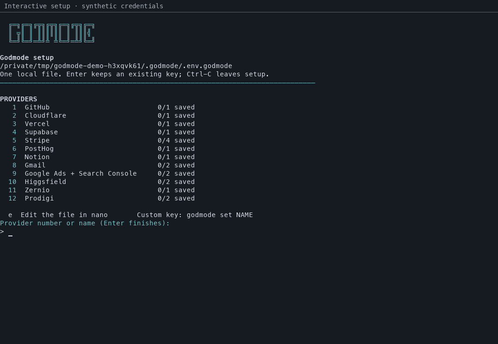

# Godmode

Godmode keeps provider credentials in one `.env.godmode` file and supplies the setup notes for obtaining them. Pick a provider in the terminal interface, read its instructions, and paste the key. Agents can then reuse the file instead of asking you to configure the same account again for each project.

The agents already know how to read an environment file, so there didn't seem much point in giving them another service to talk to. You can add an unfamiliar provider with `godmode set NAME_OF_KEY`; a TOML entry is only needed if you want its instructions in the interface. If you already have a working file, keep it. Editing it by hand works too.

The program is a single Rust executable. It needs no package manager, service or account of its own, and sends no telemetry. Credentials stay local unless you pass them to another program; what that program can do depends on the permissions attached to those credentials. See [the storage notes](docs/SECURITY.md) before adding them.



The recording uses an isolated temporary home and a synthetic key. It demonstrates local setup, not provider authentication. [How the GIF is recorded](https://github.com/lofimichael/godmode-cli/blob/main/scripts/README.md).

The interface uses a small ASCII masthead and text panels. [READTHIS.NFO](READTHIS.NFO) contains the release notes. The [language and culture study](docs/CULTURE.md) documents the period sources, including the Usenet post preserved on Ratpoison's inspiration page, and the choices made here.

## Try it without touching an existing Godmode setup

From this checkout, with Rust 1.96 installed:

```sh
cargo build --release --locked
GODMODE_DEMO_DIR=$(mktemp -d "$PWD/target/godmode-demo.XXXXXX")
./target/release/godmode \
  --home "$GODMODE_DEMO_DIR/.godmode" \
  init
```

This runs the build directly. It does not install over an existing `godmode` executable or read your normal credential directory. Use synthetic credentials for this demo. The interface asks you to type `GODMODE` before creating its local files. `--no-motion` disables animation; `NO_COLOR=1` disables color.

The source and local build are the current installation path. The repository includes a manually dispatched workflow for four release targets; a workflow file alone does not mean release binaries have been published. Check [Releases](https://github.com/lofimichael/godmode-cli/releases) for available artifacts. Repository access may require sign-in while the project is private. No crates.io package is assumed.

## Install a verified binary

The installer operates on a file you have already obtained. It makes no network requests and never writes credentials, configuration or shell profiles.

For a locally built binary:

```sh
GODMODE_BINARY_SHA=$(shasum -a 256 target/release/godmode | awk '{print $1}')
sh install.sh --binary target/release/godmode --sha256 "$GODMODE_BINARY_SHA"
```

For a downloaded release archive and its `SHA256SUMS`:

```sh
sh install.sh \
  --archive ./godmode-v0.4.0-aarch64-apple-darwin.tar.gz \
  --checksum ./SHA256SUMS
```

Choose the archive for your system: `aarch64-apple-darwin`, `x86_64-apple-darwin`, `aarch64-unknown-linux-musl`, or `x86_64-unknown-linux-musl`. The installer verifies integrity against the supplied digest; obtain both the artifact and trusted checksum from the intended release. Archives are not currently Developer ID signed or notarized, and checksums are not a signature.

The default destination is `~/.godmode/bin/godmode`. **An existing executable is refused by default.** Installer `--home DIR` keeps a separate installation under `DIR/bin`; `--bin-dir DIR` changes only the binary destination. The installer prints an absolute setup command and PATH instructions when needed. It never changes your shell profile. See [installation and existing-home detection](docs/INSTALLATION.md).

## Onboard and use a credential

Run `godmode init` or `godmode` in a terminal for interactive setup. A machine without existing Godmode configuration gets a blunt first-run explanation of account permissions and consequences before anything is created. Type `GODMODE` to acknowledge it, then choose only the providers you need.

Each provider has visible actions for sign-in (`l`), API keys (`o`) and documentation (`d`). They open the exact provider links in your browser; return to the terminal to paste the key into masked input. Enter saves it, `n` moves to the next key/provider, and `s` skips the rest of a provider. Arrow keys and Tab still let you browse freely. Full URLs are also printed by `godmode guide PROVIDER`. Nothing opens a browser or checks provider access automatically.

Saved progress comes from the credential file, so you can leave and resume. With redirected input/output, the default command prints local status; if setup is absent, it also prints the first-run notice to stderr. `init --accept-disclaimer` remains the explicit scripting path.

The command-line path is equally usable:

```sh
godmode init --accept-disclaimer
godmode guide github
godmode set GH_TOKEN
godmode status --json
godmode doctor --json
godmode run --with GH_TOKEN -- gh api user --jq .login
```

`set` opens masked input. For automation, use `set KEY --stdin` with a pipe or redirected file, or `set KEY --from-file /private/path`. There is no positional secret argument. Never put an actual credential into a shell command, issue or agent transcript. Raw JSON for a declared JSON key is compacted before saving; do not wrap it in shell quotes before pasting.

`init --accept-disclaimer` is explicit noninteractive acknowledgment of the [storage and authority terms](docs/SECURITY.md). It preserves existing credentials and rules. In a Git checkout, `.env.godmode` must be ignored and untracked before Godmode writes it.

## Picard mode

```sh
godmode picard link    # print https://picard.ytmnd.com/
godmode picard open    # open the original site
godmode picard show    # show its original image in the terminal
godmode picard play    # loop the original YTMND audio; stays in the foreground
godmode picard stop    # stop it from another terminal
```

On the provider board, `i` opens the picture, `p` toggles audio and `v` opens the original site. In the picture view, `t` switches between a fitted portrait and tiling; `i` or Esc returns to the board. `picard show` opens the picture directly without loading credentials. Its `p` key starts audio only if requested. Quitting stops any player owned by that session. When using a custom `--state-dir`, give `stop` the same directory.

The picture is the original YTMND JPEG rendered as terminal cells, with colour half-blocks or monochrome ASCII when `NO_COLOR` is set. It is a terminal adaptation of the source image, not a replica of the web page.

The recording is the approximately eight-second excerpt used by the original Picard YTMND, repeated until stopped, **not the full DarkMateria track**. The first request for a picture or audio downloads that asset from YTMND into a private local cache and checks its pinned SHA-256. Neither source asset is bundled in the code or release archive. YTMND receives the download request; no credential file is read or sent by the standalone Picard commands. Attribution and implementation details are in [PICARD.md](docs/PICARD.md).

## Commands

| Command | Result |
| --- | --- |
| `godmode` / `onboard` | Interactive provider board and masked credential entry |
| `init [--accept-disclaimer]` | Acknowledge the disclaimer and create an empty file only if absent |
| `status [--json]` | Key names and local presence; never stored values |
| `doctor [--json]` | Offline file ownership, permissions, size, symlink and syntax checks |
| `set KEY [--stdin \| --from-file PATH]` | Save or replace one key; no source flag opens masked entry |
| `unset KEY` | Remove assignments for one key, preserving unrelated content |
| `has KEY...` | Exit successfully when every requested key has a usable value |
| `guide PROVIDER` | Setup, scope, documentation and manual verification guidance |
| `providers [--json]` | List the merged provider catalog |
| `providers-template` | Print a credential-free TOML overlay template |
| `run --with KEY[=ALIAS] -- CMD...` | Give selected credentials to a child process |
| `picard [link \| open \| show \| play \| stop]` | Original YTMND picture, audio and source link |

Repeat `--with` to pass multiple credentials. In `SOURCE_KEY=CHILD_NAME`, the left side names the stored key and the right side names the child's environment variable. `run` clears the inherited environment, preserves basic process context such as PATH, HOME, locale and terminal settings, and adds only the selected credentials. Its stdout/stderr are the child's own output and are **not redacted**.

Exit codes are `0` for success, `1` for a failed `has`/`doctor` check or declined initialization, and `2` for invocation or operation errors. `run` propagates the child exit code (or `128 + signal`). `status` reports presence, not provider authentication, scope, account ownership, billing readiness or permission to act.

Global options: `--home DIR` (alias `--config-dir`), `--state-dir DIR`, `--no-motion`. Home selection uses the explicit flag, then `GODMODE_HOME`, then the compatibility variable `GODMODE_CONFIG_DIR`, then automatic discovery. State selection uses its flag, then `GODMODE_STATE_DIR`, then the selected home's default. `GODMODE_REGISTRY` selects an explicit overlay; `GODMODE_NO_MOTION=1` also disables animation.

## One credential file, optional metadata

New installations keep everything in one home:

```text
~/.godmode/
  bin/godmode          executable
  .env.godmode         credentials, mode 0600
  providers.toml       optional provider metadata, no credentials
  AGENTS.md            operating rules, if supplied separately
  state/               acknowledgements, locks and optional Picard media
```

If `~/.godmode` has no credential file, provider catalog or operating rules, an existing `~/.config/godmode` is adopted with its existing `~/.local/state/godmode/cli` state path. Installing only the new binary does not hide that legacy setup. No credentials, rules or OAuth state are migrated. An explicit `--home` selects that home and defaults its state to `DIR/state`.

Existing configuration directories and operating rules stay in place. New directories are private; state files use mode 0600. Acknowledgments are named `ack-v1-<config-path hash>` and locks `write-<config-path hash>.lock`. Writes use a private temporary file and atomic replacement; this is local plaintext storage, not encryption.

Use literal names that explain the capability: `STRIPE_TEST_SECRET_KEY`, `ACME_ACCOUNT_ADMIN_TOKEN`, `ACME_PROJECT_READ_TOKEN`. Any valid environment-variable name works without registering a provider. [Extend the catalog](docs/PROVIDERS.md) when you want that provider's instructions in the board. The bundled catalog covers twelve providers; none is mandatory. [Google OAuth](docs/GOOGLE.md) uses a separate login-state model.

Godmode gives agents access to real capabilities. It does not enforce your business authority or spending limits, and an unrestricted process running as your user can read the file. Read [the storage and authority details](docs/SECURITY.md) before storing credentials.

## Develop, release and remove

```sh
cargo fmt --all -- --check
cargo clippy --locked --all-targets -- -D warnings
cargo test --locked
sh tests/install.sh
```

[Release instructions](docs/RELEASING.md) describe local checks, CI opt-in for private repositories and the four-target draft release workflow. CI does not need provider secrets. There is no telemetry or automatic updater. Picard runs only while its foreground command or board is open; it leaves no background service.

To uninstall, first confirm which binary this installer placed, then remove that executable. Credentials and operating rules remain intact. Remove the CLI's acknowledgment/lock directory separately if no CLI process is active; do not delete an entire Godmode home merely to remove its executable. Deleting a local key does not revoke it at its provider.
