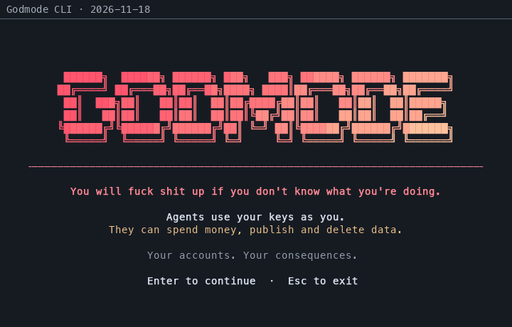

# Godmode

GODMODE gives your agents the goddamn keys. Your business profile and keys are stored in local files. Agents read profile fields and run commands with selected keys.

```text
Profile + API keys → Godmode → commands
```



## Install

macOS or Linux with Python 3.9 or newer. Downloads and source are public at [godmode.build](https://godmode.build). The interface uses Bubble Tea and Lip Gloss. Its embedded Python file engine installs no packages.

```sh
curl -fsSL https://get.godmode.build | bash
# Open a new terminal, or run the PATH command printed by the installer.
godmode
```

The navigation described below is in the current source candidate and has not been released yet. The download above may show the previous menu. See the [navigation audit](docs/dev/NAVIGATION_AUDIT.md) for the review and validation record.

After the first-use intro:

1. Open **Provider keys** and save only the keys your task needs.
2. Open **Connect agent**. Copy instructions into your current agent chat, or choose an agent and review the files before appending its note.
3. Open your project in that agent and ask for the result you want. Start a fresh agent session to load instructions saved to files.

**Business details** is optional. A saved key means local storage, not verified provider access. Godmode supplies credentials and instructions to an existing agent; it does not install or run the agent.

The CLI is free to use on any number of your machines. No account or activation
is required. Its [source-available license](LICENSE) permits inspection and
private modification; redistribution is restricted. Paid membership supplies
separate maintained playbooks, routing instructions and provider packs.

| Key | Action |
| --- | --- |
| ↑ ↓ | Select a row |
| Enter | Open a row or save a field |
| `/` | Filter providers; find an action from other menus |
| Ctrl-K | Find an action from a menu |
| `s` | Open Switch setup from a menu |
| `r` | Open Recent setups from Switch setup, when history exists |
| `?` | Show keyboard help |
| Tab | Inspect key or setup details where offered |
| Esc | Cancel an edit or return to the actual parent; clear an active provider filter first |
| `q` | Quit from menus; stays text while typing |

`godmode --plain` uses static text and numbered choices. `GODMODE_PLAIN=1` keeps that mode for later commands. Key entry stays hidden; Enter shows the proposed edit, and a second Enter saves it.

**Settings** contains Motion, Check setup, Update Godmode, and Replay intro. Motion is saved locally; `--no-motion` disables it for one command. `NO_COLOR=1` disables color. Check setup inspects local files without testing provider access. Update opens a confirmation page before handing off to the updater.

```sh
godmode settings motion off
godmode settings --json
godmode help agents
```

**Help** starts with “How do I start?” and explains setup, files, network access, and source. `godmode --help` is the command reference; bare `godmode help` remains the guide agents read.

## Connect your agent

**Connect agent** offers **Copy for this task** and **Add to agent files**. File detection covers existing Claude Code, Codex, Gemini CLI, Copilot CLI, and OpenCode folders. Choose one detected agent or explicitly choose all, then review the exact destination paths and `+` additions before Enter appends. Existing contents and edited Godmode notes stay intact. Godmode does not detect project instruction files; the copy route works with an existing agent conversation.

Copied task notes pin the selected environment and business. Global instruction files keep the generic note and tell a new task to capture its active scope. Adding a note does not verify that the agent has loaded it.

## Choose an active setup

Named environments keep complete key sets separate. Copies are snapshots: later edits do not spread to other files. Business contexts let several environments reuse one business profile.

In **Switch setup**, choose the key environment and business profile, then select **Use this setup** to save both together. Esc or Back discards the staged selection. Creating a new environment or profile is a separate explicit write; canceling the switch does not delete what you created. **Automatic** uses the selected environment's own business details.

**Recent setups** remembers up to five previously used pairs. Open it from Switch setup (or press `r` there), choose a pair, review both names, then press Enter to use it. Browsing or canceling does not change your setup.

```sh
godmode env create acme-test --copy default
godmode --env acme-test setup stripe
godmode context create acme
godmode use --env acme-test --context acme
godmode profile
godmode active
godmode agents --print
```

Use `env create acme-test` without `--copy` to start empty. Your selection is saved for new commands. Flags override shell variables (`GODMODE_ENV` / `GODMODE_CONTEXT`), which override the saved choice. `godmode use --env default --context -` returns to the original setup.

Already-running Godmode processes retain their selection. For an agent task, copy the scoped instruction in **Connect agent** or use the prefix from `godmode active --command`; both pin the business and keys even if you switch later. `godmode run` also pins nested commands. Missing keys never fall through to another file.

[Businesses and environments](docs/CONTEXTS.md) covers files, profiles and aliases. [Stripe accounts and sandboxes](docs/STRIPE_ENVIRONMENTS.md) covers account and webhook boundaries.

## Commands

| Command | What it does |
| --- | --- |
| `godmode` | Open the task menu |
| `godmode settings` | Open Settings in a terminal; print Motion state when redirected or plain |
| `godmode settings motion on\|off` | Save the local animation preference |
| `godmode settings --json` | Print Motion state and its preference-file path |
| `godmode env` | List complete named key files |
| `godmode doctor --json` | Check local files and the updater without changing them |
| `godmode update` | Update the recorded installation |
| `godmode agents --print` | Print the task note for the selected setup |
| `godmode --plain` | Static text and numbered choices |
| `godmode setup [PROVIDER]` | Add or replace a provider's keys |
| `godmode list` | Names of saved keys, never values |
| `godmode run NAME... -- CMD` | Run CMD with those keys in its environment |
| `godmode set NAME` | Save or replace a key behind a mask (`--stdin` to pipe one in) |
| `godmode profile get FIELD` | Print one profile field, such as `business_name` |
| `godmode provider [PROVIDER]` | Setup, verification and recovery guide for a provider |
| `godmode help` | The guide your agent reads, with what is saved |
| `godmode help COMMAND` | Help for one command; also available as `COMMAND --help` |
| `godmode faq` | Answers about Godmode |
| `godmode source` | Print the embedded Python file engine |
| `godmode build-info` | Compiler, dependencies and engine hash |
| `godmode license status` | Inspect a legacy signed local entitlement |
| `godmode license deactivate` | Release this installation without changing provider keys |

## Files

| Path | Contents |
| --- | --- |
| `~/.godmode/profile.json` | Your profile, plain JSON, readable only by you |
| `~/.godmode/.env.godmode` | Your keys, each value encrypted |
| `~/.godmode/seal.key` | Decrypts them. Anyone with both files has your keys. |
| `~/.godmode/ui.json` | Optional nonsecret Motion preference and up to five recent setup pairs |

Provider keys stay local. Godmode stores credentials; provider tools handle sign-in and refresh. `Saved` means stored on this machine. Ordinary commands work offline without a license. Legacy activation and deactivation contact godmode.build. [Licensing](docs/LICENSING.md) describes the exact data and behavior.

Update with `godmodeup`. To uninstall, run `rm -rf ~/.godmode` (this deletes your keys too) and remove the two `# Godmode` lines from your shell startup file. Deleting a key here does not revoke it; revoke it at the provider.

Each release provides a separate source archive containing Go, Python and vendored dependencies. `godmode source` prints the native command's embedded file engine; `godmode build-info` lists its hash and the Go dependencies. `scripts/build-native.sh` rebuilds reviewed source for a byte-for-byte comparison. [Security](docs/SECURITY.md) covers release checksums, local files, and the trust in downloaded code.

[Installation](docs/INSTALLATION.md) · [Profile](docs/PROFILE.md) · [Agents](docs/AGENT_SETUP.md) · [Providers](docs/PROVIDERS.md) · [Remote machines](docs/REMOTE.md) · [Security](docs/SECURITY.md)
