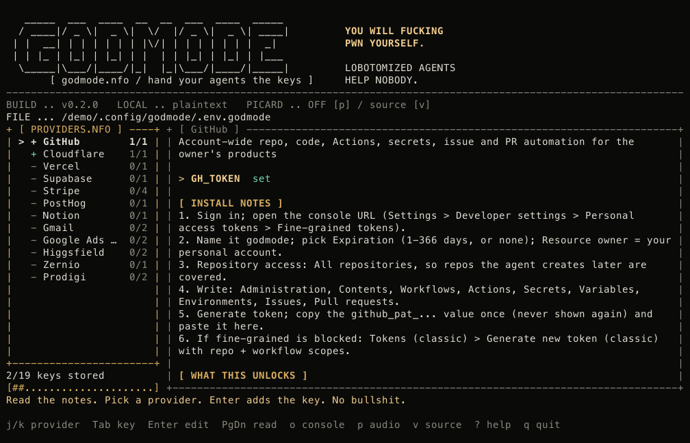

# GODMODE

```text
[ GODMODE / RELEASE NOTES ]
ONE FILE. REAL KEYS. READ THE FUCKING SCOPES.
```

**Give your agents the keys. Try not to fucking pwn yourself.**

Godmode puts reusable provider credentials in one `.env.godmode` and gives you a terminal full of actual setup instructions. Pick a provider, read what its token can do, paste it into a masked field, get on with it. Got some obscure provider? Use its literal key names or add a TOML entry. No key-factory bullshit.

One Rust binary. No Homebrew dance. No account with us. No telemetry. Your keys stay on your machine until you hand them to a command. That command can spend, delete, publish, or print them according to its access. This is a power tool, not an undo button.

The interface borrows the structure of 2000s scene NFOs: original ASCII lettering, compact release fields, install notes, and a blunt `READTHIS.NFO`. Its voice is an intentional blend of NFO/readme culture, gamer slang, and YTMND-era web humor. [The historical research](docs/CULTURE.md) separates the evidence from the nostalgia. We aren't claiming that all Usenet sounded like this, or pretending to be a warez group.



The warning is blunt; the file operations remain precise. [Read the NFO](READTHIS.NFO).

## Try it without touching an existing Godmode setup

From this checkout, with Rust 1.96 installed:

```sh
cargo build --release --locked
GODMODE_DEMO_DIR=$(mktemp -d "$PWD/target/godmode-demo.XXXXXX")
./target/release/godmode \
  --config-dir "$GODMODE_DEMO_DIR/config" \
  --state-dir "$GODMODE_DEMO_DIR/state" \
  onboard
```

This runs the build directly. It does not install over an existing `godmode` executable or read your normal credential directory. Use synthetic credentials for this demo. The interface asks you to type `GODMODE` before creating its local files. `--no-motion` disables animation; `NO_COLOR=1` disables color.

The source and local build are the current installation path. The repository includes a manually dispatched workflow for four release targets; a workflow file alone does not mean release binaries have been published. Check [Releases](https://github.com/lofimichael/godmode-cli/releases) for available artifacts. Repository access may require sign-in while the project is private. No crates.io package is assumed.

## Install a verified binary

The installer operates on a file you have already obtained. It makes no network requests and never writes credentials, configuration or shell profiles.

For a locally built binary:

```sh
GODMODE_BINARY_SHA=$(shasum -a 256 target/release/godmode | awk '{print $1}')
sh install.sh --binary target/release/godmode --sha256 "$GODMODE_BINARY_SHA"
```

For a downloaded release archive and its `SHA256SUMS`:

```sh
sh install.sh \
  --archive ./godmode-v0.2.0-aarch64-apple-darwin.tar.gz \
  --checksum ./SHA256SUMS
```

Choose the archive for your system: `aarch64-apple-darwin`, `x86_64-apple-darwin`, `aarch64-unknown-linux-musl`, or `x86_64-unknown-linux-musl`. The installer verifies integrity against the supplied digest; obtain both the artifact and trusted checksum from the intended release. Archives are not currently Developer ID signed or notarized, and checksums are not a signature.

The destination is `~/.local/bin/godmode`. **An existing executable is refused by default.** Use `--bin-dir /your/directory` for a separate installation. `--force` explicitly replaces a regular destination file; a symlink is always refused. If the directory is not on your PATH, invoke the full path. The installer never modifies PATH for you.

## Onboard and use a credential

Run `godmode` in a terminal to open the provider board. Read the disclaimer, choose only the providers you need, and save keys individually. Progress comes from the file, so you can leave and resume. With redirected input/output, the default command prints local status instead of opening a full-screen interface.

The command-line path is equally usable:

```sh
godmode init --accept-disclaimer
godmode guide github
godmode set GH_TOKEN
godmode status --json
godmode doctor --json
godmode run --with GH_TOKEN -- gh api user --jq .login
```

`set` opens masked input. For automation, use `set KEY --stdin` with a pipe or redirected file, or `set KEY --from-file /private/path`. There is no positional secret argument. Never put an actual credential into a shell command, issue or agent transcript. Raw JSON for a declared JSON key is compacted before saving; do not wrap it in shell quotes before pasting.

`init --accept-disclaimer` is explicit noninteractive acknowledgment of the [storage and authority terms](docs/SECURITY.md). It preserves existing credentials and rules. In a Git checkout, `.env.godmode` must be ignored and untracked before Godmode writes it.

## Picard mode

```sh
godmode picard link    # print https://picard.ytmnd.com/
godmode picard open    # open the original site
godmode picard play    # loop the original YTMND audio; stays in the foreground
godmode picard stop    # stop it from another terminal
```

On the provider board, `p` toggles playback and `v` opens the original site. Quitting the board stops its player. There is no autoplay. When using a custom `--state-dir`, give `stop` the same directory.

The recording is the approximately eight-second excerpt used by the original Picard YTMND, repeated until stopped, **not the full DarkMateria track**. First playback downloads that exact audio from YTMND into a private local cache and checks its pinned SHA-256. The recording is not bundled in the source or release archive. YTMND receives the download request; no credential file is read or sent for Picard mode. Attribution and implementation details are in [PICARD.md](docs/PICARD.md).

## Commands

| Command | Result |
| --- | --- |
| `godmode` / `onboard` | Interactive provider board and masked credential entry |
| `init [--accept-disclaimer]` | Acknowledge the disclaimer and create an empty file only if absent |
| `status [--json]` | Key names and local presence; never stored values |
| `doctor [--json]` | Offline file ownership, permissions, size, symlink and syntax checks |
| `set KEY [--stdin \| --from-file PATH]` | Save or replace one key; no source flag opens masked entry |
| `unset KEY` | Remove assignments for one key, preserving unrelated content |
| `has KEY...` | Exit successfully when every requested key has a usable value |
| `guide PROVIDER` | Setup, scope, documentation and manual verification guidance |
| `providers [--json]` | List the merged provider catalog |
| `providers-template` | Print a credential-free TOML overlay template |
| `run --with KEY[=ALIAS] -- CMD...` | Give selected credentials to a child process |
| `picard [link \| open \| play \| stop]` | Optional original YTMND audio and source link |

Repeat `--with` to pass multiple credentials. In `SOURCE_KEY=CHILD_NAME`, the left side names the stored key and the right side names the child's environment variable. `run` clears the inherited environment, preserves basic process context such as PATH, HOME, locale and terminal settings, and adds only the selected credentials. Its stdout/stderr are the child's own output and are **not redacted**.

Exit codes are `0` for success, `1` for a failed `has`/`doctor` check or declined initialization, and `2` for invocation or operation errors. `run` propagates the child exit code (or `128 + signal`). `status` reports presence, not provider authentication, scope, account ownership, billing readiness or permission to act.

Global options: `--config-dir DIR`, `--state-dir DIR`, `--no-motion`. Directory flags override `GODMODE_CONFIG_DIR` and `GODMODE_STATE_DIR`. `GODMODE_REGISTRY` selects an explicit overlay; `GODMODE_NO_MOTION=1` also disables animation.

## One credential file, optional metadata

Defaults:

```text
~/.local/bin/godmode                  executable, if installed
~/.config/godmode/.env.godmode        credentials, mode 0600
~/.config/godmode/providers.toml      optional provider metadata, no credentials
~/.local/state/godmode/cli/           local acknowledgments, locks and optional Picard cache
```

Existing configuration directories and operating rules stay in place. New directories are private; state files use mode 0600. Acknowledgments are named `ack-v1-<config-path hash>` and locks `write-<config-path hash>.lock`. Writes use a private temporary file and atomic replacement; this is local plaintext storage, not encryption.

Use literal names that explain the capability: `STRIPE_TEST_SECRET_KEY`, `ACME_ACCOUNT_ADMIN_TOKEN`, `ACME_PROJECT_READ_TOKEN`. Any valid environment-variable name works without registering a provider. [Extend the catalog](docs/PROVIDERS.md) when you want that provider's instructions in the board. The bundled catalog covers twelve providers; none is mandatory. [Google OAuth](docs/GOOGLE.md) uses a separate login-state model.

Godmode gives agents access to real capabilities. It does not enforce your business authority or spending limits, and an unrestricted process running as your user can read the file. Read [the storage and authority details](docs/SECURITY.md) before storing credentials.

## Develop, release and remove

```sh
cargo fmt --all -- --check
cargo clippy --locked --all-targets -- -D warnings
cargo test --locked
sh tests/install.sh
```

[Release instructions](docs/RELEASING.md) describe local checks, CI opt-in for private repositories and the four-target draft release workflow. CI does not need provider secrets. There is no telemetry or automatic updater. Picard runs only while its foreground command or board is open; it leaves no background service.

To uninstall, first confirm which binary this installer placed, then remove that executable. Credentials and operating rules remain intact. Remove the CLI's acknowledgment/lock directory separately if no CLI process is active; never recursively delete `~/.config/godmode` to uninstall this tool. Deleting a local key does not revoke it at its provider.
