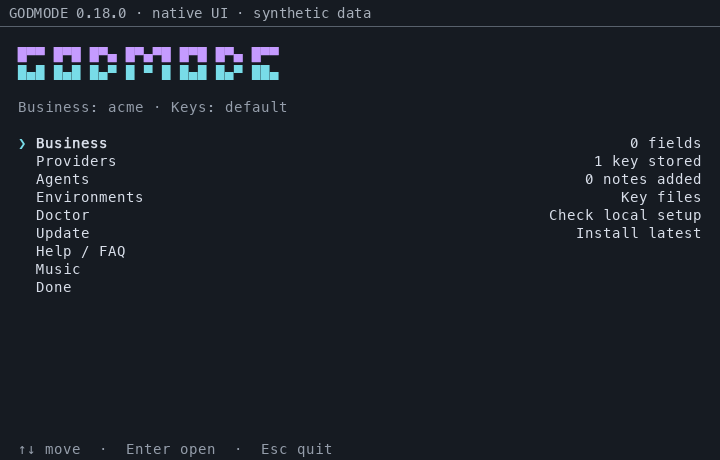

# Godmode

GODMODE gives your agents the goddamn keys. Your business profile and keys are stored in local files. Agents read profile fields and run commands with selected keys.

```text
Profile + API keys → Godmode → commands
```



## Install

macOS or Linux with Python 3.9 or newer. Downloads and source are public at [godmode.build](https://godmode.build). The interface uses Bubble Tea and Lip Gloss. Its embedded Python file engine installs no packages.

```sh
curl -fsSL https://get.godmode.build | bash
godmode
```

`godmode` shows the selected business and key file, with equal rows for **Business**, **Providers**, **Agents**, and **Environments**. **Doctor** checks local files; **Update** updates the recorded installation. Profile fields and providers remain optional.

The CLI is free to use on any number of your machines. No account or activation
is required. Its [source-available license](LICENSE) permits inspection and
private modification; redistribution is restricted. Paid membership supplies
separate maintained playbooks, routing instructions and provider packs.

| Key | Action |
| --- | --- |
| ↑ ↓ | Select a row |
| Enter | Open a row or save a field |
| `/` | Search providers |
| Tab | Open details |
| Esc | Go back |

`godmode --plain` uses static text and numbered choices. `GODMODE_PLAIN=1` keeps that mode for later commands. Key entry stays hidden; Enter shows the proposed edit, and a second Enter saves it.

`--no-motion` disables animation. `NO_COLOR=1` disables color. **Help / FAQ** answers questions about sealing, token paths, network access, and source.

## Connect your agent

**Agents** finds Claude Code, Codex, Gemini CLI, Copilot CLI, and OpenCode. Green `+` lines show the note and the files to create or modify. Enter on **Add to…** appends the note. Existing file contents and edited Godmode notes stay intact. The note stays visible and copyable after installation. Copied task notes include the selected environment and business; global instruction files keep the generic note. New agent sessions run `godmode help` when a task needs a key or profile field.

## Separate businesses and key files

Named environments keep complete key sets separate. Copies are snapshots: later edits do not spread to other files. Business contexts let several environments reuse one business profile.

```sh
godmode env create acme-test --copy default
godmode --env acme-test setup stripe
godmode context create acme
godmode --context acme profile
godmode --env acme-test --context acme agents --print
```

Use `env create acme-test` without `--copy` to start empty. Every command selects its own environment and business, so concurrent agents do not switch one another's selection. Missing keys never fall through to another file.

[Businesses and environments](docs/CONTEXTS.md) covers files, profiles and aliases. [Stripe accounts and sandboxes](docs/STRIPE_ENVIRONMENTS.md) covers account and webhook boundaries.

## Music

`godmode music` plays local tracks through an initialized [Darunia's CLI](https://github.com/lofimichael/darunias-cli) installation. The visualizer follows the rendered audio. Synthesized tracks stay cached; `godmode music clear` removes the cache. The [music adapter](docs/MUSIC.md) has no bundled songs, fonts, or synth tools and can be omitted from the build.

## Commands

| Command | What it does |
| --- | --- |
| `godmode` | Open the status screen |
| `godmode env` | List complete named key files |
| `godmode doctor --json` | Check local files and the updater without changing them |
| `godmode update` | Update the recorded installation |
| `godmode agents --print` | Print the task note for the selected files |
| `godmode --plain` | Static text and numbered choices |
| `godmode setup [PROVIDER]` | Add or replace a provider's keys |
| `godmode list` | Names of saved keys, never values |
| `godmode run NAME... -- CMD` | Run CMD with those keys in its environment |
| `godmode set NAME` | Save or replace a key behind a mask (`--stdin` to pipe one in) |
| `godmode profile get FIELD` | Print one profile field, such as `business_name` |
| `godmode provider [PROVIDER]` | Setup, verification and recovery guide for a provider |
| `godmode help` | The guide your agent reads, with what is saved |
| `godmode faq` | Answers about Godmode |
| `godmode music` | Local music and visualizer |
| `godmode music clear` | Remove synthesized music from the cache |
| `godmode source` | Print the embedded Python file engine |
| `godmode build-info` | Compiler, dependencies and engine hash |
| `godmode license status` | Inspect a legacy signed local entitlement |
| `godmode license deactivate` | Release this installation without changing provider keys |

## Files

| Path | Contents |
| --- | --- |
| `~/.godmode/profile.json` | Your profile, plain JSON, readable only by you |
| `~/.godmode/.env.godmode` | Your keys, each value encrypted |
| `~/.godmode/seal.key` | Decrypts them. Anyone with both files has your keys. |

Provider keys stay local. Godmode stores credentials; provider tools handle sign-in and refresh. `Saved` means stored on this machine. Ordinary commands work offline without a license. Legacy activation and deactivation contact godmode.build. [Licensing](docs/LICENSING.md) describes the exact data and behavior.

Update with `godmodeup`. To uninstall, run `rm -rf ~/.godmode` (this deletes your keys too) and remove the two `# Godmode` lines from your shell startup file. Deleting a key here does not revoke it; revoke it at the provider.

Each release provides a separate source archive containing Go, Python and vendored dependencies. `godmode source` prints the native command's embedded file engine; `godmode build-info` lists its hash and the Go dependencies. `scripts/build-native.sh` rebuilds reviewed source for a byte-for-byte comparison. [Security](docs/SECURITY.md) covers release checksums, local files, and the trust in downloaded code.

[Installation](docs/INSTALLATION.md) · [Profile](docs/PROFILE.md) · [Agents](docs/AGENT_SETUP.md) · [Providers](docs/PROVIDERS.md) · [Remote machines](docs/REMOTE.md) · [Security](docs/SECURITY.md) · [Music](docs/MUSIC.md) · [Picard](docs/PICARD.md)
