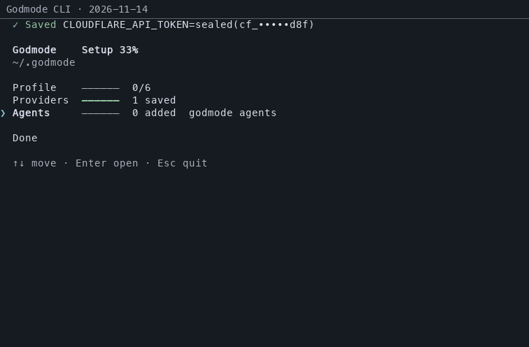
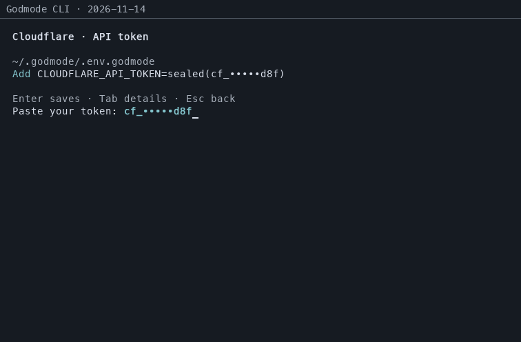
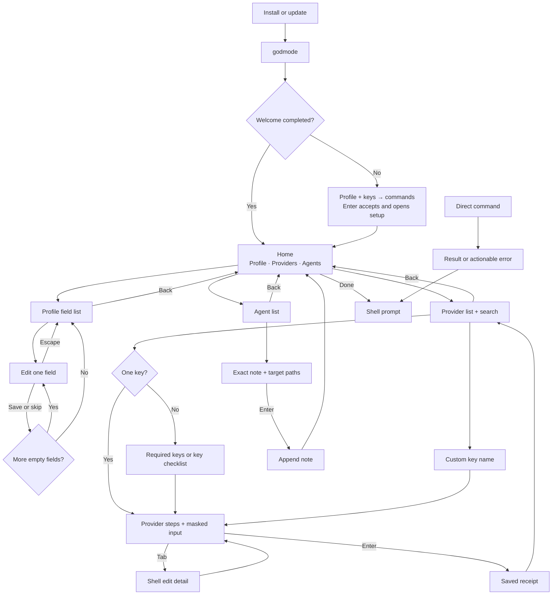

# Godmode CLI experience

Godmode stores profile fields and provider keys, then supplies them to commands. Its interface has two routes: guided setup for choosing and editing, and direct commands for repeat work and automation.

## Research

| Source | Pattern | Application |
| --- | --- | --- |
| [Evil Martians: CLI progress](https://evilmartians.com/chronicles/cli-ux-best-practices-3-patterns-for-improving-progress-displays), April 15, 2024 | Measured X/Y progress, restrained bars, clean final output | Counts accompany setup bars. A local save produces a receipt without an animation. |
| [Evil Martians: Devs in mind](https://evilmartians.com/chronicles/devs-in-mind-how-to-design-interfaces-for-developer-tools), January 14, 2025 | Developer work switches among tasks and contexts | Profile, providers, and agents remain independent. Direct commands skip the welcome. |
| [Evil Martians: five dev tool patterns](https://evilmartians.com/chronicles/keep-it-together-5-essential-design-patterns-for-dev-tool-uis), May 7, 2024 | Label-value properties, clear active states, restrained tables | Short aligned rows replace repeated descriptions. A pointer identifies selection without color. |
| [Evil Martians: layout rule](https://evilmartians.com/chronicles/devtool-layout-rule), August 5, 2024 | A choice normally controls content below or to its right | A provider row precedes its description, fields, and save action. |
| [Evil Martians: HTTPie](https://evilmartians.com/chronicles/ui-design-for-httpie-macos-vibes-for-the-api-testing-client), January 30, 2023 | A compact layout preserves working space; onboarding starts with a working request | First use leads to a real saved key. Extra headings and stacked panels do not compete with the input. |
| [GitHub CLI accessibility](https://github.blog/engineering/user-experience/building-a-more-accessible-github-cli/), May 2, 2025; updated May 12 | Sequential prompts, static progress, terminal-owned colors | Plain mode uses ordinary numbered choices. Theme colors and words preserve readable state. |
| [GitHub CLI foundations](https://github.com/cli/cli/blob/trunk/docs/primer/foundations/README.md), read November 14, 2026 | Human output and machine output have different needs | Guided mode uses visual status; direct data output stays complete and pipeable. |
| [Charm Huh](https://github.com/charmbracelet/huh#accessibility), read November 14, 2026 | Focused fields; accessible mode replaces redraws with standard prompts | Plain mode is a separate interaction mode. Disabling color alone does not select it. |
| [Charm Gum](https://github.com/charmbracelet/gum), read November 14, 2026 | Small selection, filter, input, and confirmation controls | Provider search reduces the catalog without introducing a new runtime. |
| [Command Line Interface Guidelines](https://clig.dev/), read November 14, 2026 | Useful help, purposeful symbols, actionable errors, composable output | Common commands appear first. Errors name the repair. Direct commands keep their output contracts. |
| [uv style guide](https://raw.githubusercontent.com/astral-sh/uv/main/STYLE.md), read November 14, 2026 | Meaning survives without styling; data and logs use separate streams | Counts and status words remain readable with no color. Errors stay on stderr. |
| [Stripe CLI login](https://docs.stripe.com/cli/login), read November 14, 2026 | Browser, manual, and headless paths are explicit | Key entry keeps a visible provider link and a separate stdin route. |

## Routes

## Guided setup

| Surface | Visible content | Action and return |
| --- | --- | --- |
| Install | Installed version, command location, setup command | Opens setup unless `--no-setup` is set. `--path` controls shell integration. |
| Update | Current version or old → new version | Replaces installed program files. `--setup` opens setup. |
| Welcome | One compact relationship diagram, local storage, concrete consequences of using keys | Enter completes the welcome. Escape exits without marking it complete. |
| Home | Overall setup meter; profile, provider, and agent rows with their own counts and bars | Enter opens a row. Done or Escape returns to the shell with a short summary. |
| Providers | Provider names and saved state; description for the selected row | `/` starts search. Enter opens the selected provider. Back returns home. |
| One-key provider | Key name, provider link, numbered acquisition steps, masked input, destination and assignment | Enter with an empty field opens the provider page. Enter with a valid value saves it. Escape returns without saving. |
| Required key group | The next missing required key | A successful save advances through the group. Cancellation preserves earlier saves. |
| Alternative key group | Each key and saved state | The user chooses a key. A valid alternative set completes that provider's local setup. |
| Custom key | Name entry, followed by masked value entry | Valid names use letters, digits, and underscores. Names ending in `_JSON` accept JSON files. |
| Save details | Shell equivalent and exceptional edits, such as duplicate-line removal | Tab opens or closes detail. The normal view keeps the destination, key name, and masked value visible. |
| Save error | Specific problem beside the input | Correct the value or cancel. Invalid input is never committed. |
| Save result | Key name and saved state | Returns to the provider context. No separate success page. |
| Profile | Six label-value rows with a filled-field count | Enter edits one field. Saved fields remain visible; missing fields remain reachable. |
| Profile field | Label, current value, editable input | Enter saves, skips an empty new field, or keeps an empty edit, then opens the next empty field. `/clear` removes the field. Escape returns to the list. |
| Agents | Detected agents, existing note state, exact note, and destination paths | Enter on Add writes the previewed note. Copy or print supports other agents. |
| Agent preview | Complete note and exact destination paths | Enter appends only after the complete preview fits. Escape returns. Plain mode prints the complete preview before confirming. |
| Agent result | Added file paths | Returns to the task. Existing instruction text remains intact. |
| Exit | Setup amount and local counts | Returns immediately to the shell. |

Provider instructions remain numbered because the provider's own interface still requires those actions. A picture cannot replace a scope name or the account choice.

The profile fields are `operator_name`, `business_name`, `legal_name`, `website`, `public_email`, and `business_mailing_address`. Empty fields remain optional during work; the meter describes how much of the profile is stored.

## Direct commands

| Command | Result |
| --- | --- |
| `godmode`, `godmode onboard` | Guided home, preceded by the welcome only on first use |
| `godmode intro` | Replays the welcome |
| `godmode setup [PROVIDER]` | Provider selection or direct provider setup |
| `godmode set NAME` | Masked key entry with a save preview |
| `godmode set NAME --stdin` | Saves one key from a pipe or file |
| `godmode list` | One saved key name per line; no values |
| `godmode run NAME... -- CMD` | Replaces Godmode with CMD and supplies only the requested saved keys |
| `godmode run VAR=NAME -- CMD` | Supplies a saved key under another environment variable name |
| `godmode profile`, `godmode profile edit` | Profile field menu |
| `godmode profile get FIELD` | One field value; a missing field exits with status 1 |
| `godmode profile show` | Complete profile as JSON |
| `godmode profile set FIELD [--stdin]` | Visible field entry, or piped field input |
| `godmode profile unset FIELD` | Removes one field |
| `godmode profile path` | Profile file location |
| `godmode agents` | Guided agent setup; redirected output contains only the instruction note |
| `godmode provider` | Provider names and purposes |
| `godmode provider SLUG` | Credential setup, scope, verification, recovery, and official links |
| `godmode help` | Saved names and profile-field state, followed by the agent usage contract |
| `godmode --help`, `godmode -h` | Compact command reference |
| `godmode COMMAND --help` | Command-specific syntax, actions, and examples |
| `godmode run --help` | Key forwarding and variable mapping syntax |
| `godmode path` | Key file location |
| `godmode edit` | Opens the selected key file in nano |
| `godmode migrate` | Seals compatible legacy keys after verifying the copied values |
| `godmode --version` | Installed version |
| `godmode picard [link\|open\|show\|play\|stop]` | Explicit optional media action, separate from setup and credentials |
| `godmode init` | Compatibility entry point for onboarding |

`--home DIR` selects a home; `--config-dir`, `GODMODE_HOME`, and `GODMODE_CONFIG_DIR` retain their existing compatibility. The legacy `init --accept-disclaimer` path remains for existing automation. `--state-dir` selects optional Picard state. These controls do not expand what a key authorizes.

## Installation and recovery

| Route | Behavior |
| --- | --- |
| Online install | Downloads the selected compatible release, checks its SHA-256, installs the readable Python program and updater, then opens setup |
| Private release | Uses an existing authorized GitHub CLI login |
| Offline archive | `--archive PATH --checksum SHA256SUMS` verifies and installs the supplied archive |
| Offline program | `--binary PATH --sha256 HEX` verifies and installs the supplied script |
| Alternate destination | `--home DIR` selects the data and executable home; `--bin-dir DIR` changes only the executable directory |
| Shell integration | `--path` backs up the startup file before adding the generated environment file |
| Existing executable | The install receipt identifies managed files; `--force` explicitly adopts an unknown existing program |
| Update and rollback | `godmodeup` checks the current release and preserves the previous executable as `godmode.previous` |
| Missing command | Source the generated environment file or use the installed executable's full path |
| Legacy keys | `migrate` reads back the sealed copy before replacing the legacy source; conflicts identify names and line numbers |
| Malformed data | A specific error preserves the data; `edit`, `migrate`, or profile editing provides the relevant repair |
| Remote machine | The [remote guide](../REMOTE.md) describes copying the selected files to an owned machine |
| Remove programs | The [installation guide](../INSTALLATION.md#uninstall) separates deleting program files from deleting the profile and keys |
| Revoke access | Provider-side revocation remains a provider action; removing a local key does not revoke it |

The installer remains standard-library Python on macOS and Linux, with Python 3.9 or newer. No new UI framework, package manager, or background service is required.

## Completion

The setup meter has 18 points. Each of the six profile fields contributes one point. One complete provider key set contributes six points. One agent note contributes six points. A custom key can satisfy the provider portion. Additional providers remain available without becoming a requirement.

| Component | Full amount | Visible state |
| --- | --- | --- |
| Profile | 6 fields | Filled count out of 6 |
| Providers | 1 usable saved key set | Number of saved providers, plus partial sets |
| Agents | 1 added note | Added agent count or a manually added note |

The total uses integer flooring, so 100% requires all three portions. `Saved` describes local storage. `Added` describes an instruction note. Neither word claims that a provider accepted a key or that an agent ran a command.

## Copy and space

| v0.13 behavior | Revised behavior | Reduction |
| --- | --- | --- |
| Three welcome pages and three Enter presses | One welcome and one Enter press | Two screens and two Enter presses |
| 158 words in welcome titles and prose | 25 words in the title and prose | 84% fewer words; diagram and controls counted separately |
| A three-provider target for the provider third | One usable saved provider fills that third | Two provider enrollments removed from the completion target |
| One overall bar and text states | Three status rows with small bars and counts | Each component shows its own completion |
| Provider name, state, and every description | Name and state; selected description | Only one provider description at a time |
| Long shell edit and encryption explanation during every key entry | File and masked assignment; shell detail on Tab | Detailed shell syntax leaves the default input view |
| Agent purpose, file list, note, actions, and hints compete for one screen | Shorter note, exact file rows, and complete-preview gate | Repeated explanation leaves the preview |
| No sequential guided mode | `--plain` and `GODMODE_PLAIN=1` | Cursor redraws become numbered prompts |
| Global help for most subcommands | Command-specific syntax and examples | Each command exposes only its relevant options |

Copy names the object and state: `Profile 3/6`, `Providers 2 saved`, `GH_TOKEN saved`, `Add to Codex`. Keyboard hints occupy one footer. Text that changes the decision stays visible: the file, replacement, invalid value, required provider scope, and cancellation action.

The visual vocabulary is small. `›` or `>` marks selection. A check plus a status word marks a saved item. Counts describe partial state. Bars show amount. Default terminal colors carry ordinary text; accents identify selection and status. Unicode has an ASCII equivalent.

## Alternatives

| Alternative | Decision |
| --- | --- |
| Full-screen dashboard with bordered cards | Reject. Borders and padding consume rows needed for fields and instructions. |
| A Go, Node, Rich, or Textual rewrite | Reject. The existing standard-library renderer supports the required interactions. |
| Automatic provider login and refresh | Reject. Godmode remains a credential store and command launcher. |
| Connect every provider to reach 100% | Reject. Useful setup requires only the services the user chooses. |
| A spinner or animated meter during entry | Reject. User input has no measurable time remaining. |
| Emoji-only or Nerd Font controls | Reject. Font dependence and ambiguous speech make status harder to read. |
| Hide all instructions behind detail | Reject. Provider scope and exact changes determine whether the action is correct. |
| Preserve a partial agent preview with an active Add action | Reject. The full proposed note and destinations must be readable before a write. |
| Treat `NO_COLOR` as plain mode | Reject. Color, glyphs, and cursor redraws are separate capabilities. |
| Replace direct output with visual tables | Reject. Existing scripts require complete names, JSON, and child-command output. |

## Verification

| Area | Required checks |
| --- | --- |
| State | Empty, partial, complete, malformed keys, malformed profile, and no detected agents |
| Size | 80×24, 60×20, narrow width, short height, long paths, and resizing during a prompt |
| Rendering | UTF-8, ASCII, light and dark palettes, `NO_COLOR`, `TERM=dumb`, plain mode, and redirected output |
| Entry | Typed key, bracketed paste, multiline JSON, dragged file, invalid input, replacement, and duplicate-key cleanup |
| Navigation | Search, empty result, Escape clearing search, Escape leaving a form, Ctrl-C, and return after save |
| Agent changes | Exact preview, too-small preview gate, existing note, appended note, and partial write failure |
| Commands | Stable `list`, `run`, profile JSON, provider guide, help, exit codes, and stdout/stderr behavior |
| Preservation | Existing key and profile data, instruction text, terminal state, unrelated files, and installer rollback |

Walkthroughs use synthetic keys and temporary homes. Compare first key, replacement key, profile completion, agent addition, and return visits. Count actual screen transitions and actions. Capture real terminal output for visual review. The executed results belong in the release record.
