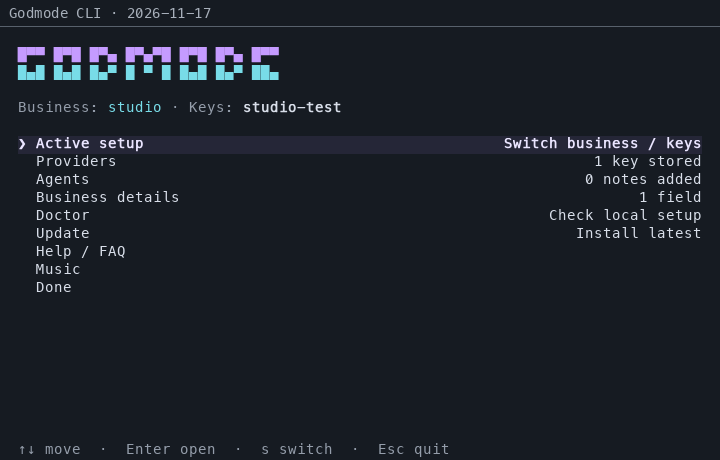
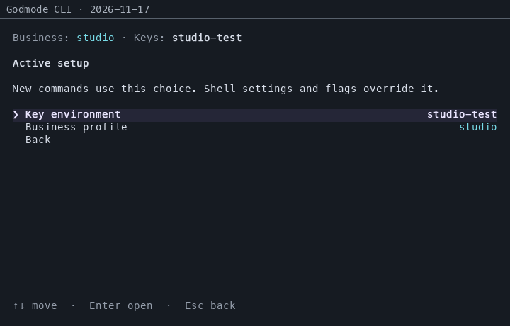
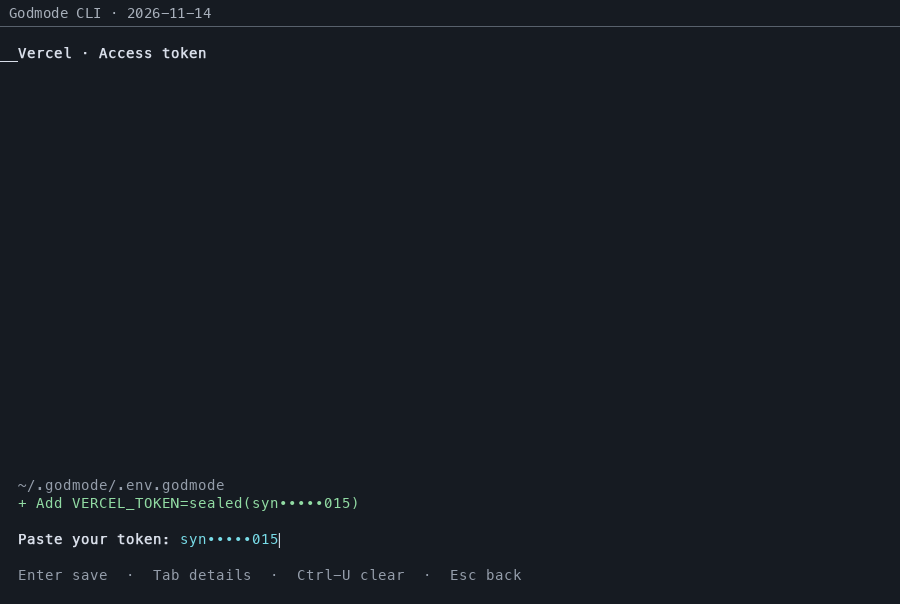
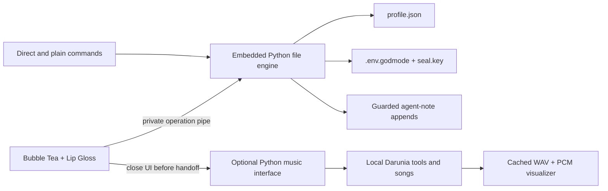
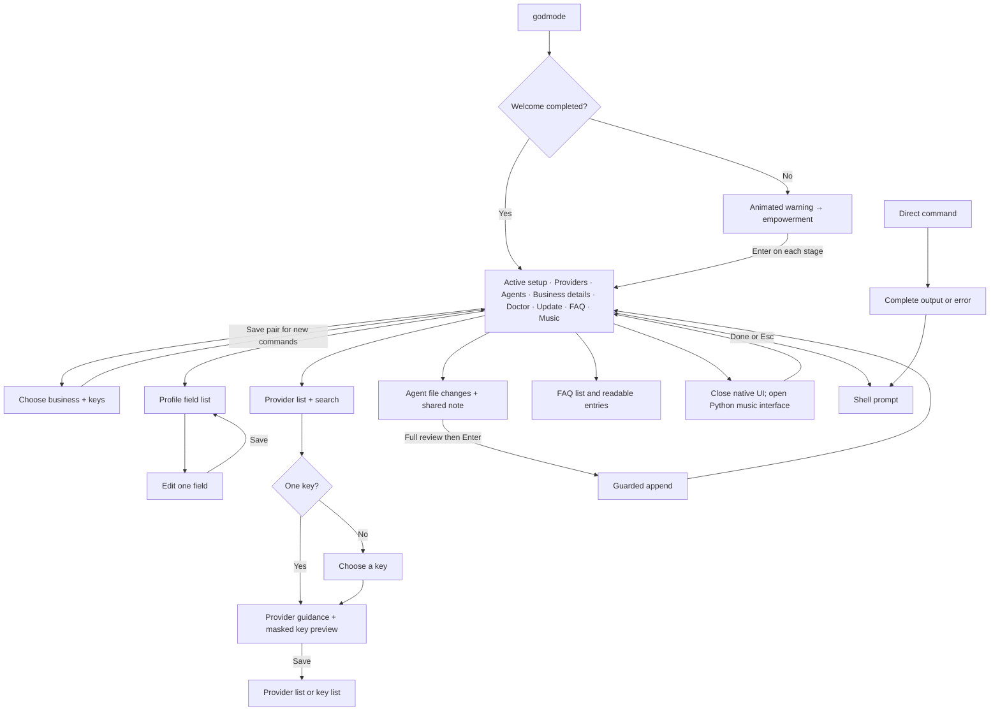

# Godmode CLI experience

Godmode stores profile fields and provider keys, then supplies selected keys to commands. This guide describes the native 0.19 interface. Direct commands and the Python plain/compatibility interface retain their own output contracts.

## Native interface

Bubble Tea 2 and Lip Gloss 2 draw the NFO welcome and guided views. The home uses aligned rows for Active setup, Providers, Agents, Business details, Doctor, Update, Help / FAQ, Music and Done. Business and keys stay visible across pages. Active setup leads to separate key-environment and business-profile pickers and saves the complete pair. The intro has an immediate warning-to-empowerment transition, a repeating gradient animation and no forced wait. Selected rows pulse briefly; delayed loading indicators appear only during real work. See [active setup](ACTIVE_SELECTION.md), [intro direction](INTRO_DIRECTION.md) and [performance review](PERFORMANCE_REVIEW.md).

The Go interface temporarily holds newly entered text. The Python engine validates it, supplies masked key previews, retains file snapshots and performs writes. It never returns a stored plaintext secret to the interface. One Python process serves each native UI session; the executable embeds its source and passes it on a descriptor separate from request input.

[Framework research](CLI_FRAMEWORKS.md) compares ten libraries across Python, Go, Rust and TypeScript. [NFO identity](NFO_DESIGN.md) records the source voice and visual choices. Complete source is available in the separate release source archive; `godmode source` prints the embedded Python engine and `godmode build-info` reports its hash and Go dependencies.

## Research

| Source | Pattern | Application |
| --- | --- | --- |
| [Evil Martians: CLI progress](https://evilmartians.com/chronicles/cli-ux-best-practices-3-patterns-for-improving-progress-displays), April 15, 2024 | Measured X/Y progress, restrained bars, clean final output | Counts accompany setup bars. A local save produces a receipt without an animation. |
| [Evil Martians: Devs in mind](https://evilmartians.com/chronicles/devs-in-mind-how-to-design-interfaces-for-developer-tools), January 14, 2025 | Developer work switches among tasks and contexts | Profile, providers, and agents remain independent. Direct commands skip the welcome. |
| [Evil Martians: five dev tool patterns](https://evilmartians.com/chronicles/keep-it-together-5-essential-design-patterns-for-dev-tool-uis), May 7, 2024 | Label-value properties, clear active states, restrained tables | Short aligned rows replace repeated descriptions. A pointer identifies selection without color. |
| [Evil Martians: layout rule](https://evilmartians.com/chronicles/devtool-layout-rule), August 5, 2024 | A choice normally controls content below or to its right | A provider row precedes its description, fields, and save action. |
| [Evil Martians: HTTPie](https://evilmartians.com/chronicles/ui-design-for-httpie-macos-vibes-for-the-api-testing-client), January 30, 2023 | A compact layout preserves working space; onboarding starts with a working request | First use leads to a real saved key. Extra headings and stacked panels do not compete with the input. |
| [GitHub CLI accessibility](https://github.blog/engineering/user-experience/building-a-more-accessible-github-cli/), May 2, 2025; updated May 12 | Sequential prompts, static progress, terminal-owned colors | Plain mode uses ordinary numbered choices. Theme colors and words preserve readable state. |
| [GitHub CLI foundations](https://github.com/cli/cli/blob/trunk/docs/primer/foundations/README.md), read November 14, 2026 | Human output and machine output have different needs | Guided mode uses visual status; direct data output stays complete and pipeable. |
| [Charm Huh](https://github.com/charmbracelet/huh#accessibility), read November 14, 2026 | Focused fields; accessible mode replaces redraws with standard prompts | Plain mode is a separate interaction mode. Disabling color alone does not select it. |
| [Charm Gum](https://github.com/charmbracelet/gum), read November 14, 2026 | Small selection, filter, input, and confirmation controls | Provider search reduces the catalog with a slash filter in the current interface. |
| [Command Line Interface Guidelines](https://clig.dev/), read November 14, 2026 | Useful help, purposeful symbols, actionable errors, composable output | Common commands appear first. Errors name the repair. Direct commands keep their output contracts. |
| [uv style guide](https://raw.githubusercontent.com/astral-sh/uv/main/STYLE.md), read November 14, 2026 | Meaning survives without styling; data and logs use separate streams | Counts and status words remain readable with no color. Errors stay on stderr. |
| [Stripe CLI login](https://docs.stripe.com/cli/login), read November 14, 2026 | Browser, manual, and headless paths are explicit | Key entry keeps a visible provider link and a separate stdin route. |

## Routes

`intro` always replays the welcome. On a fresh home, native `setup` and `set NAME` also show it before opening their requested route. Native `profile`, `agents` and `faq` open their sections directly. Back from a section opened as its own command exits; back from a section opened through home returns home.

## Guided setup

| Surface | Visible content | Action and return |
| --- | --- | --- |
| Welcome | Original block lettering, local-file statement and consequences of account access | Enter accepts only while the complete statement/action fit. Esc exits without recording completion. Explicit `intro` exits after acceptance; other routes continue to their destination. |
| Home | Overall meter, three setup counts, FAQ, Music and Done | Enter opens a selection. Back from Profile focuses Providers; back from Providers focuses Agents; back from Agents focuses FAQ. Done or Esc exits without a final setup summary. |
| Providers | Names, saved state and selected description | `/` filters the catalog. Enter opens a match. Esc clears active search first. An empty search result does not open a provider or URL. |
| One-key provider | Bold visit heading, separate link, spaced instruction bullets, masked input and file preview | Empty Enter opens the provider page when available. Valid input saves only on Enter; paste never submits. Esc abandons the field. |
| Multiple-key provider | Key checklist and saved states | Choose a key. After save, the checklist selects the next missing key, or Back once a required/alternative set is complete. It does not automatically open the next field. |
| Custom key | Name entry followed by key input | Type a valid name using letters, digits and underscores. Name fields ignore pastes. `_JSON` keys accept a validated object or supported file input. |
| Key preview | Target path, `+ Add` or `± Replace` and masked assignment | The complete input/review area must fit before Enter can save. Tab toggles shell-equivalent detail. Existing plaintext secret values are never shown. |
| Key error | Validation message or actionable file error | Correct the entry or cancel. Invalid input is not committed. |
| Key save | Masked receipt in the return context | Return to provider/key list. A direct `set NAME` exits after save. No separate success screen. |
| Profile | One business-details paragraph and six optional label-value fields | Enter opens the selected field. Stored values remain visible. |
| Profile field | Existing value and editable text | Enter saves, skips an empty new value or keeps an emptied existing value; `/clear` removes it. Return to the list with the next row selected. Esc returns without saving. |
| Agent preview | Created/modified target groups, addition/removal counts and one shared note | Scroll through the entire preview before Enter appends. Width changes reset review progress. A terminal below the minimum review size cannot append. `c` copies the note when a clipboard tool is available. |
| No detected agent | Shared note for manual use | Copy/select it, then `m` marks it added only after review. This marker describes a user action, not verified agent execution. |
| Agent result | Added-file count | Return to home or exit a direct `agents` session. Existing instructions remain intact. |
| FAQ | Topic list followed by scrollable explanations | Enter opens a topic; Esc returns to the list. |
| Music | Local song picker, cached synthesis and PCM spectrum | The native session closes before the Python music interface takes the terminal. Returning from music starts a fresh native home session. |

The profile fields are `operator_name`, `business_name`, `legal_name`, `website`, `public_email`, and `business_mailing_address`. A provider instruction must still name the correct scope, account and page. Brief copy does not remove information needed for a decision.

## Commands and compatibility

| Command | Result |
| --- | --- |
| `godmode`, `godmode onboard` | Native home in a capable interactive terminal; first-use welcome when needed |
| `godmode intro` | Replay welcome |
| `godmode setup [PROVIDER]` | Native catalog or requested provider |
| `godmode set NAME` | Native masked entry and preview |
| `godmode set NAME --stdin` | Save one key from a pipe/file through the core |
| `godmode list` | Saved key names, one per line; no values |
| `godmode run NAME... -- CMD` | Supply requested stored keys to CMD; native parent waits and relays termination signals, preserving streams and child exit status |
| `godmode run VAR=NAME -- CMD` | Supply a stored key under another environment variable name |
| `godmode profile` | Native field list |
| `godmode profile edit` | Python compatibility field menu |
| `godmode profile get FIELD` | One value; missing field exits 1 |
| `godmode profile show` | Complete profile JSON |
| `godmode profile set FIELD [--stdin]` | Python field entry or piped value |
| `godmode profile unset FIELD`, `profile path` | Remove one field; print profile path |
| `godmode agents` | Native append preview; redirected output contains the instruction note |
| `godmode provider [SLUG]` | Catalog summary or printable provider guide |
| `godmode faq` | Native topic list; core output when plain or redirected |
| `godmode help` | Saved names/profile state and agent usage contract |
| `godmode --help`, `godmode COMMAND --help` | Command reference and command-specific help |
| `godmode path`, `edit`, `migrate` | Print key-file path; open nano; verify and seal compatible legacy keys |
| `godmode source`, `build-info` | Embedded Python source; core hash, compiler and dependency metadata |
| `godmode music [init\|list\|play\|status\|clear\|forget]` | Explicit optional local synthesis and playback; see [Music](../MUSIC.md) |
| `godmode picard [link\|open\|show\|play\|stop]` | Explicit optional Picard media |
| `godmode --version` | Version only |
| `godmode init` | Compatibility alias for onboarding |

`--home DIR`, `--config-dir`, `GODMODE_HOME` and `GODMODE_CONFIG_DIR` retain their existing core selection behavior. `init --accept-disclaimer` remains a compatibility route. `--state-dir` selects Picard state; music state is under the selected Godmode home. None of these controls expands a key's authority.

The native launcher handles guided routes only with both input and output attached to a suitable terminal. `--plain`, `GODMODE_PLAIN=1`, an empty/dumb `TERM`, and redirected operation use the Python path. Plain key entry displays a masked review after Enter and saves on a second Enter. The compatibility menu may advance through fields differently from the native list; it is not the native renderer without color.

## Installation and recovery

The shell installer selects a compatible native release for macOS/Linux ARM64 or x86-64, checks its SHA-256, installs the executable and updater, and opens setup unless disabled. Python 3.9+ remains required. Native installation needs neither Go nor pip; source builds use pinned Go 1.26.7 and vendored modules.

| Route | Behavior |
| --- | --- |
| Private release | Existing GitHub CLI login supplies repository access |
| Offline archive | `--archive PATH --checksum SHA256SUMS` verifies/installs the supplied compatible archive |
| Offline program | `--binary PATH --sha256 HEX` verifies/installs the supplied executable |
| Alternate destination | `--home DIR` selects data/executable home; `--bin-dir DIR` changes executable directory only |
| Shell integration | `--path` backs up startup files before adding the generated environment source line |
| Existing executable | Receipt identifies managed files; `--force` explicitly adopts an unknown existing program |
| Update | `godmodeup` preserves the previous executable as `godmode.previous`; `--setup` explicitly opens setup |
| Legacy keys | `migrate` verifies the sealed copy before replacing the compatible legacy file |
| Remove programs | [Installation](../INSTALLATION.md#uninstall) distinguishes programs from keys/profile |
| Remote machine | [Remote guide](../REMOTE.md) explains explicit selected-file copies |
| Revoke access | Revoke at the provider; deleting a local key does not revoke it |

## Completion and visual rules

The setup meter has 18 points: six optional profile fields contribute one each, one complete stored provider set contributes six, and one agent note contributes six. A custom key can satisfy the provider portion. More providers are optional. The total uses integer flooring. `Saved` means stored locally; `Added` means an instruction note exists or the user marked a manual addition. Neither proves live provider access or successful agent execution.

The native interface uses Unicode block art, arrows, separators and bars. It currently has no complete ASCII substitution layer; use plain mode for ASCII-oriented terminals. Light/dark palettes adapt to terminal background information. `NO_COLOR=1` and `CLICOLOR=0` retain selection text and symbols without color. `--no-motion` or `GODMODE_NO_MOTION=1` suppresses decorative motion; the native welcome also skips its reveal when colors are disabled. Plain mode provides static sequential output. Music has its own monochrome visualizer and no-motion behavior.

File previews carry meaning in text and signs, not color alone. Native keys show `+ Add` or `± Replace` with a masked assignment. Agent appends show plus-prefixed additions and a zero removal count. Ordinary field entry has no spinner or invented progress animation. Direct outputs remain complete and pipeable.

## Design boundaries

| Choice | Current decision |
| --- | --- |
| Go terminal framework | Bubble Tea and Lip Gloss are the selected default; Python retains file operations and compatibility routes |
| Responsive home | Three unbordered columns when space permits; compact rows otherwise |
| Source inspection | Embedded engine through `source`; complete matching sources and vendor tree in the separate source archive |
| Provider login/refresh | Provider tools own these operations; Godmode stores credentials |
| Full-catalog completion target | Not required; only chosen services need setup |
| Agent append review | Every preview section must be reviewed before write; existing file text is preserved |
| Color versus plain mode | Distinct controls; plain mode changes interaction, not only styling |
| Optional music | Local synth integration, separate process and removable adapter; no tools/fonts/songs bundled |

The [0.15 verification record](UX_VERIFICATION.md) contains the executed native, compatibility, packaging and preservation checks.

## Verification requirements

| Area | Required checks |
| --- | --- |
| State | Empty, partial, complete, malformed store/profile, no detected agents |
| Size | Wide/narrow/short terminals, long paths, resizing during entry and agent review |
| Rendering | Light/dark, no color, no motion, native Unicode, plain ASCII, dumb terminal and redirected output |
| Entry | Typed key, complete/fragmented bracketed paste, large-paste refusal, JSON/file input, replacement and invalid values |
| Navigation | Search/no match, Escape behavior, Ctrl-C, profile return selection, multi-key checklist and direct-route exit |
| Agent changes | Exact preview, scroll gate, width-change re-review, prior note, guarded append and partial failure |
| Commands | Stable names/JSON/guides, stdin, child streams/signals/exit codes, source/build-info |
| Preservation | Existing keys/profile/instructions, terminal state, unrelated files, updater backup and removable music |

Use synthetic keys and temporary homes. Record native and compatibility checks separately. Screenshots, successful local storage and protocol tests do not prove provider permissions, paid demand or screen-reader usability. Executed results belong in the release verification record.
