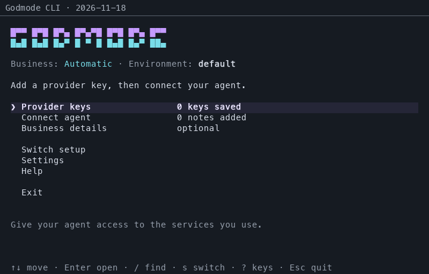
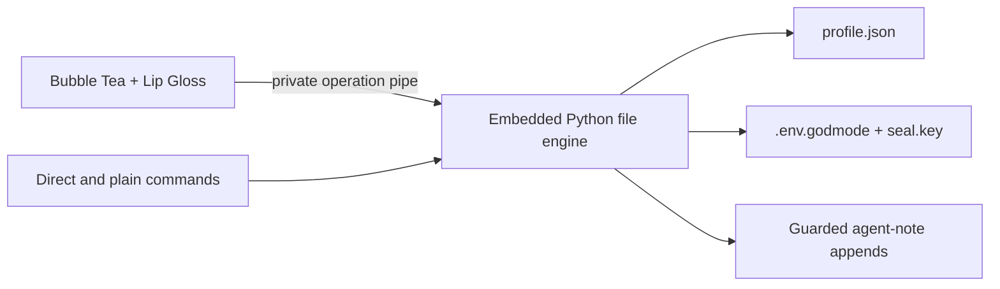
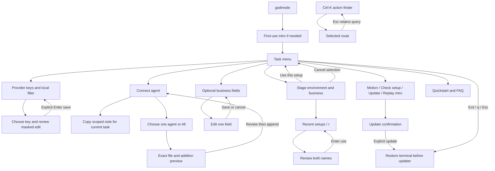

# Godmode CLI experience

Godmode stores profile fields and provider keys, then supplies selected keys to commands. This guide describes the current native source candidate; its navigation changes are not released yet. Direct commands and the Python plain/compatibility interface retain their own output contracts. The [navigation audit](NAVIGATION_AUDIT.md) records the earlier navigation work and its evidence. The home capture below shows the current candidate.

The setup and key-edit images are historical examples.

## Native interface

Bubble Tea 2 and Lip Gloss 2 draw the NFO welcome and guided views. Home leads with Provider keys, Connect agent and Business details, followed by Switch setup, Settings, Help and Exit. The active business and key environment remain visible. Switch setup stages both choices until Use this setup saves the pair. Recent setups recalls up to five used pairs and requires a review before applying one. Ctrl-K finds an action; / filters providers or opens the finder from other menus. Esc returns to the actual parent, retaining focus and query; q quits from menus and remains text in an input. See the [navigation audit](NAVIGATION_AUDIT.md), [active selection contract](ACTIVE_SELECTION.md), [intro direction](INTRO_DIRECTION.md) and [performance review](PERFORMANCE_REVIEW.md).

The Go interface temporarily holds newly entered text. The Python engine validates it, supplies masked key previews, retains file snapshots and performs writes. It never returns a stored plaintext secret to the interface. One Python process serves each native UI session; the executable embeds its source and passes it on a descriptor separate from request input.

[Framework research](CLI_FRAMEWORKS.md) compares ten libraries across Python, Go, Rust and TypeScript. [NFO identity](NFO_DESIGN.md) records the source voice and visual choices. Complete source is available in the separate release source archive; `godmode source` prints the embedded Python engine and `godmode build-info` reports its hash and Go dependencies.

## Research

The current [navigation research](navigation-audit/research.md) compares ten CLI/TUI examples using primary sources and separates documented behavior from design inference. The [audit](NAVIGATION_AUDIT.md#cli-comparisons-and-design-inferences) explains which patterns were adopted. Earlier [framework research](CLI_FRAMEWORKS.md) remains the record of the framework choice. These comparisons are not human usability experiments or a ranking of the tools.

## Routes

`intro` replays the welcome. On a fresh home, native `setup` and `set NAME` also show it before their requested route. Native `profile`, `agents`, `faq` and `settings` open their sections directly. Back follows the actual navigation history. Leaving a direct entry route returns to the terminal; a provider reached through the finder returns to its query. See the audit for the complete route map and scope semantics.

Recent setups is available from Switch setup, its `r` shortcut, and the action finder when history exists. It records up to five applied pairs in `ui.json`; browsing, cancellation and unselected creation do not add history. Choosing a row shows both names before Enter applies them together. A separate history-write warning does not undo an already saved active pair. See the [tested semantics](NAVIGATION_AUDIT.md#recent-setup-pairs).

Back restores provider, help, scope and agent-target identity as well as menu position. Recent entries are matched by pair, so reordered history cannot change what a detail screen means. Returning to Connect agent after a non-agent detour reloads its plan asynchronously; an exact target is retained when available, and a refreshed file diff must be reviewed again. Missing targets and an old All preview return to Connect agent rather than expanding the write.

## Guided setup

| Surface | Visible content | Action and return |
| --- | --- | --- |
| Welcome | Original block lettering and account-access consequences | Enter advances only while the required statement/action fit. Esc exits without recording completion. |
| Home | Three primary tasks, secondary setup/settings/help and Exit | Empty state starts at keys; a saved key with no agent note points toward Connect agent. Counts describe inventory, not a completion score. |
| Provider keys | Names, saved state, selected description and overflow position | / filters locally. Esc clears active filtering first. No-match Enter cannot open a provider or URL. |
| Provider key | Guidance, shortened link, masked input, destination and change preview | Empty Enter can open the provider page. Paste never submits. Valid input saves on explicit Enter only when review fits; Esc abandons it. |
| Multiple-key provider | Key checklist and saved states | Choose a key; returning preserves its list context. |
| Custom key | Name entry, then masked input | Name fields ignore pastes. Supported JSON values retain the existing validation path. |
| Business details | Six optional fields and existing values | Opens directly from Home. Saving a detail does not publish it. |
| Profile field | Prefilled text and explicit clear behavior | Save/unchanged/remove receipt reflects the backend result. Esc discards the draft. Return retains the field-list route. |
| Connect agent | Copy for this task or Add to agent files | Current-task copy is separate from permanent instruction-file changes. |
| Agent target choice | Detected destinations plus explicit All and Back | Choose one or all, then inspect the exact preview. Arbitrary project files are not detected. |
| Agent preview | Selected paths, additions/removals and append block | Continuous review unlocks Enter append; jumping past unseen lines does not. Width changes restart review. Append returns to Connect agent. |
| Switch setup | Current pair and staged environment/business choices | Use this setup saves both once. Back cancels the selection. Explicitly created records remain even if selection is later canceled. |
| Recent setups | Up to five applied environment/business pairs | Choose a pair, review both names, then Enter uses it. Cancel preserves active state and any unapplied manual draft. |
| Settings | Motion, Check setup, Update Godmode, Replay intro | Motion persists in ui.json; command no-motion overrides do not rewrite it. Update requires confirmation before external handoff. |
| Help | Quickstart first, then connection/scope/files/source topics | Enter opens a topic; Esc returns to its list or finder origin. ? opens keyboard help from menus. |

The profile fields are `operator_name`, `business_name`, `legal_name`, `website`, `public_email`, and `business_mailing_address`. A provider instruction must still name the correct scope, account and page. Brief copy does not remove information needed for a decision.

## Commands and compatibility

| Command | Result |
| --- | --- |
| `godmode`, `godmode onboard` | Native home in a capable interactive terminal; first-use welcome when needed |
| `godmode intro` | Replay welcome |
| `godmode setup [PROVIDER]` | Native catalog or requested provider |
| `godmode set NAME` | Native masked entry and preview |
| `godmode set NAME --stdin` | Save one key from a pipe/file through the core |
| `godmode list` | Saved key names, one per line; no values |
| `godmode run NAME... -- CMD` | Supply requested stored keys to CMD; native parent waits and relays termination signals, preserving streams and child exit status |
| `godmode run VAR=NAME -- CMD` | Supply a stored key under another environment variable name |
| `godmode profile` | Native field list |
| `godmode profile edit` | Python compatibility field menu |
| `godmode profile get FIELD` | One value; missing field exits 1 |
| `godmode profile show` | Complete profile JSON |
| `godmode profile set FIELD [--stdin]` | Python field entry or piped value |
| `godmode profile unset FIELD`, `profile path` | Remove one field; print profile path |
| `godmode agents` | Native copy/target chooser and guarded append; redirected output contains the instruction note |
| `godmode provider [SLUG]` | Catalog summary or printable provider guide |
| `godmode faq` | Native topic list; core output when plain or redirected |
| `godmode help` | Saved names/profile state and agent usage contract |
| `godmode --help`, `godmode COMMAND --help`, `godmode help COMMAND` | Command reference and command-specific help; bare help remains the agent guide |
| `godmode settings` | Native Settings in a terminal; plain/redirected output reports Motion |
| `godmode settings motion on\|off`, `settings --json` | Save Motion; inspect preference and local ui.json path |
| `godmode path`, `edit`, `migrate` | Print key-file path; open nano; verify and seal compatible legacy keys |
| `godmode source`, `build-info` | Embedded Python source; core hash, compiler and dependency metadata |
| `godmode --version` | Version only |
| `godmode init` | Compatibility alias for onboarding |

`--home DIR`, `--config-dir`, `GODMODE_HOME` and `GODMODE_CONFIG_DIR` retain their existing core selection behavior. `init --accept-disclaimer` remains a compatibility route. None of these controls expands a key's authority.

The native launcher handles guided routes only with both input and output attached to a suitable terminal. `--plain`, `GODMODE_PLAIN=1`, an empty/dumb `TERM`, and redirected operation use the Python path. Plain key entry displays a masked review after Enter and saves on a second Enter. The compatibility menu may advance through fields differently from the native list; it is not the native renderer without color.

## Installation and recovery

The shell installer selects a compatible native release for macOS/Linux ARM64 or x86-64, checks its SHA-256, installs the executable and updater, and opens setup unless disabled. Python 3.9+ remains required. Native installation needs neither Go nor pip; source builds use pinned Go 1.26.7 and vendored modules.

| Route | Behavior |
| --- | --- |
| Private release | Existing GitHub CLI login supplies repository access |
| Offline archive | `--archive PATH --checksum SHA256SUMS` verifies/installs the supplied compatible archive |
| Offline program | `--binary PATH --sha256 HEX` verifies/installs the supplied executable |
| Alternate destination | `--home DIR` selects data/executable home; `--bin-dir DIR` changes executable directory only |
| Shell integration | `--path` backs up startup files before adding the generated environment source line |
| Existing executable | Receipt identifies managed files; `--force` explicitly adopts an unknown existing program |
| Update | `godmodeup` preserves the previous executable as `godmode.previous`; `--setup` explicitly opens setup |
| Legacy keys | `migrate` verifies the sealed copy before replacing the compatible legacy file |
| Remove programs | [Installation](../INSTALLATION.md#uninstall) distinguishes programs from keys/profile |
| Remote machine | [Remote guide](../REMOTE.md) explains explicit selected-file copies |
| Revoke access | Revoke at the provider; deleting a local key does not revoke it |

## Completion and visual rules

The native task menu does not use a completion percentage. Business fields and unused providers are optional. `Saved` means stored locally; an appended note means the specified file changed. Neither proves provider access, agent instruction loading or successful execution. Current-task copying is its own operation and does not mark file installation complete.

The native interface uses Unicode block art, arrows, separators and bars. It currently has no complete ASCII substitution layer; use plain mode for ASCII-oriented terminals. Light/dark palettes adapt to terminal background information. `NO_COLOR=1` and `CLICOLOR=0` retain selection text and symbols without color. Motion can be saved in Settings or with `godmode settings motion off`. `--no-motion` or `GODMODE_NO_MOTION=1` overrides it for the current command; the native welcome also skips its reveal when colors are disabled. Plain mode provides static sequential output.

File previews carry meaning in text and signs, not color alone. Native keys show `+ Add` or `± Replace` with a masked assignment. Agent appends show plus-prefixed additions and a zero removal count. Ordinary field entry has no spinner or invented progress animation. Direct outputs remain complete and pipeable.

## Design boundaries

| Choice | Current decision |
| --- | --- |
| Go terminal framework | Bubble Tea and Lip Gloss are the selected default; Python retains file operations and compatibility routes |
| Responsive home | Aligned task rows; compact scope/header/footer at narrow sizes; list overflow remains visible |
| Source inspection | Embedded engine through `source`; complete matching sources and vendor tree in the separate source archive |
| Provider login/refresh | Provider tools own these operations; Godmode stores credentials |
| Full-catalog completion target | Not required; only chosen services need setup |
| Agent append review | Chosen target paths and append block must be reviewed before write; task copy is separate; existing file text is preserved |
| Color versus plain mode | Distinct controls; plain mode changes interaction, not only styling |

The [0.15 verification record](UX_VERIFICATION.md) is historical. The current [navigation audit](NAVIGATION_AUDIT.md#validation-checkpoints-actually-completed) records executed candidate checks and separates frozen reviewer checkpoints from the unreleased final candidate. No public release or installation was performed by that audit.

## Verification requirements

| Area | Required checks |
| --- | --- |
| State | Empty, partial, complete, malformed store/profile, no detected agents |
| Size | Wide/narrow/short terminals, long paths, resizing during entry and agent review |
| Rendering | Light/dark, no color, no motion, native Unicode, plain ASCII, dumb terminal and redirected output |
| Entry | Typed key, complete/fragmented bracketed paste, large-paste refusal, JSON/file input, replacement and invalid values |
| Navigation | Search/no match, Escape behavior, Ctrl-C, profile return selection, multi-key checklist and direct-route exit |
| Agent changes | Exact preview, scroll gate, width-change re-review, prior note, guarded append and partial failure |
| Commands | Stable names/JSON/guides, stdin, child streams/signals/exit codes, source/build-info |
| Preservation | Existing keys/profile/instructions, terminal state, unrelated files, updater backup |

Use synthetic keys and temporary homes. Record native and compatibility checks separately. Screenshots, successful local storage and protocol tests do not prove provider permissions, paid demand or screen-reader usability. Executed results belong in the release verification record.
